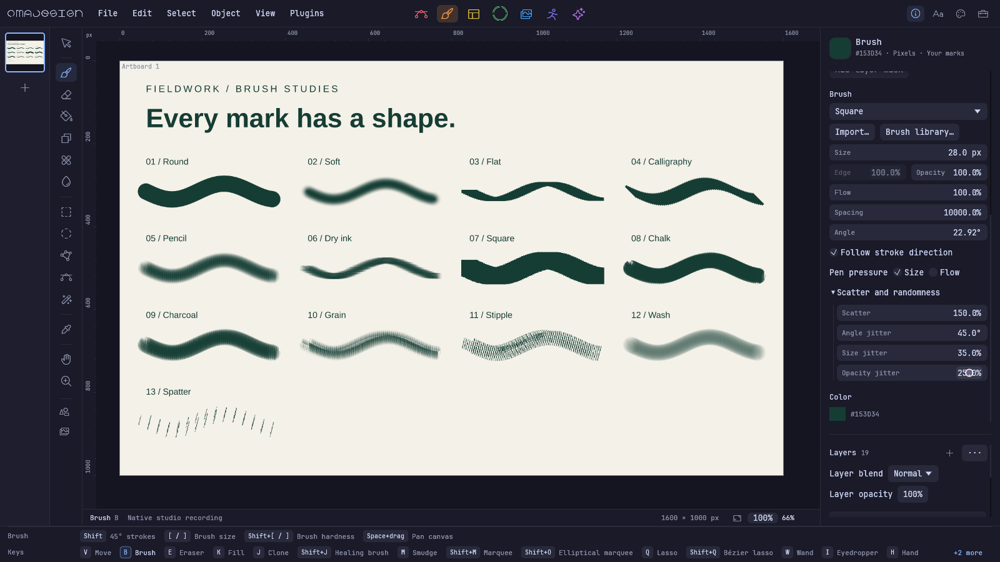

# Brushes that follow your hand

Paint with 13 original tips. Rotate a tip, follow your stroke, spread the marks, or vary their angle, size and opacity. The cursor shows the tip's actual outline. Square joins Essentials. Spacing reaches 10,000%.

[Get 0.6.3-nightly.20261013.0001](https://github.com/michaelmonetized/omadesign/releases/tag/v0.6.3-nightly.20261013.0001). It's the latest release and the default website download. The usual installer line installs it.

Wayland and X11 pens can control Size and Flow independently. Very light pressure keeps a continuous stroke. Pen hover, contact and side buttons are supported; tilt, tablet pad controls, physical tool rotation and automatic reverse-side eraser switching are still outside this release. Physical tablet acceptance remains unverified.

Rotated multi-object selections scale along their rotated handles. Moving across the canvas no longer changes the sidebar width. Brush spacing carries through pointer samples, erasing and masks.

Fred Nix's fixes keep open paths open in PDF and animated SVG, preserve compound fill rules and Simplify endpoints, smooth clone opacity, and correct glass edges. File loading rejects overflowing raster dimensions and object IDs, validates XCF mask tiles, and allocates legacy artboard IDs safely. Photo preset name conflicts and failed cloud token saves are handled cleanly.

Brush packs arrived after the October 2 post: import Photoshop ABR, Illustrator artwork, PNG or SVG; save presets and share portable packs. [Download the original CC0 packs and an editable brush study](/brushes). Adobe dynamics are not reproduced and imported third-party packs stay private.

OmaStore now uses the official install-and-launch entry. Installation checks versions and archive hashes, repairs missing stock files, and preserves edited starter plugins.

The README, docs and site now show current native artwork. The five studios, brush controls and product film were captured from the real editor. [The source documents are editable](https://github.com/michaelmonetized/omadesign/tree/v0.6.3-nightly.20261013.0001/examples/product-media).

[Full release notes](https://github.com/michaelmonetized/omadesign/blob/v0.6.3-nightly.20261013.0001/docs/releases/0.6.3-nightly.20261013.0001.md).
